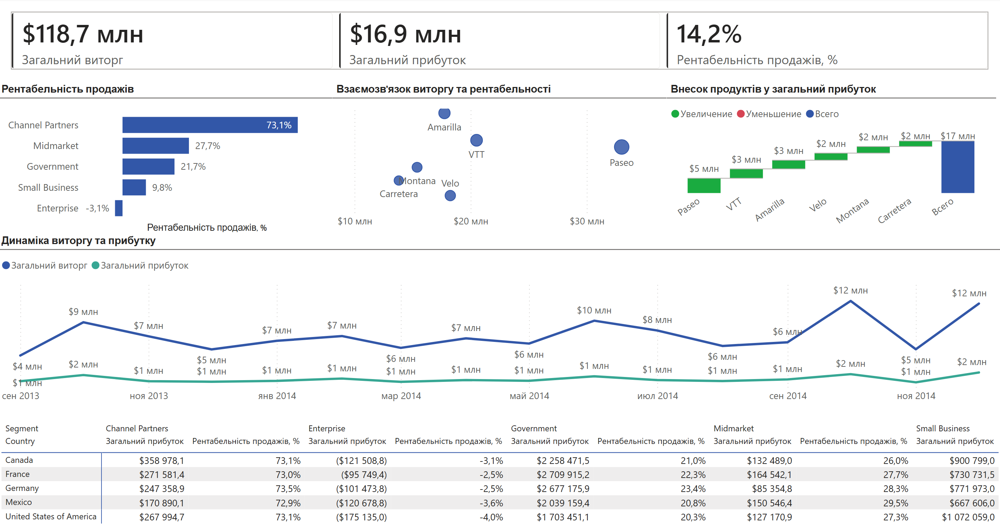

## Вигляд дашборду

# Фінансово-економічний аналіз продажів | Power BI

## Про проєкт

Інтерактивний аналітичний дашборд, розроблений у Microsoft Power BI на основі навчального набору даних Financial Sample від Microsoft.

Мета проєкту — дослідження фінансових результатів, оцінювання прибутковості продажів, аналіз структури виторгу та виявлення факторів, що впливають на ефективність бізнесу.

## Основні показники (KPI)

- Загальний виторг — 118,7 млн дол.
- Загальний прибуток — 16,9 млн дол.
- Рентабельність продажів — 14,2%.

## Реалізовані візуалізації

1. Ключові фінансові показники (KPI).
2. Динаміка виторгу та прибутку.
3. Рентабельність продажів за сегментами.
4. Взаємозв'язок виторгу та рентабельності за продуктами.
5. Аналіз внеску продуктів у загальний прибуток.
6. Фінансові результати за країнами та сегментами.

## Інструменти та технології

- Microsoft Power BI
- DAX — розрахунок аналітичних показників
- Power Query — підготовка та обробка даних
- Excel — джерело даних

## Джерело даних

Microsoft Financial Sample Dataset — навчальний набір фінансових даних.

## Призначення

Проєкт створено для практичного застосування методів бізнес-аналітики, фінансово-економічного аналізу та інтерактивної візуалізації даних.
