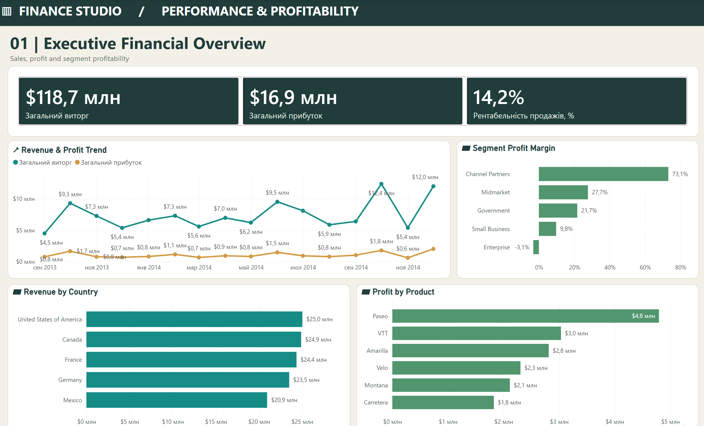
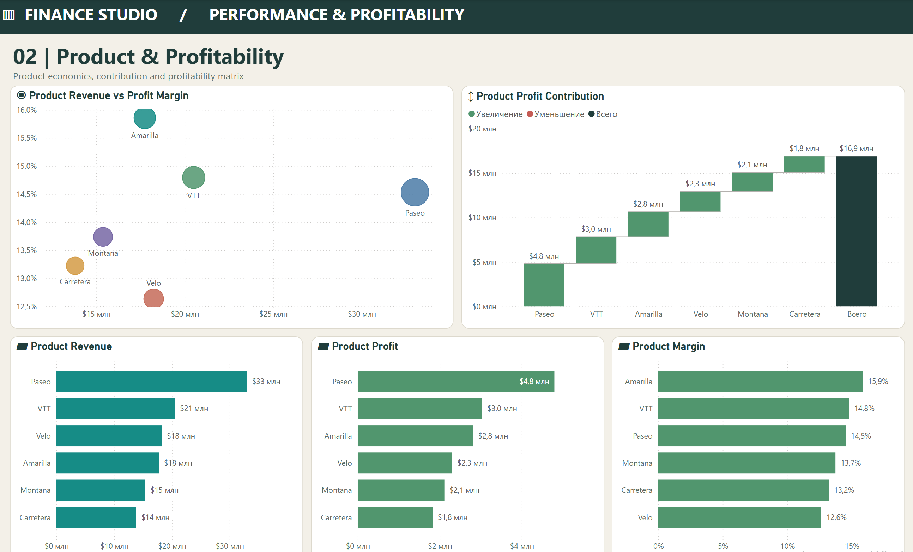
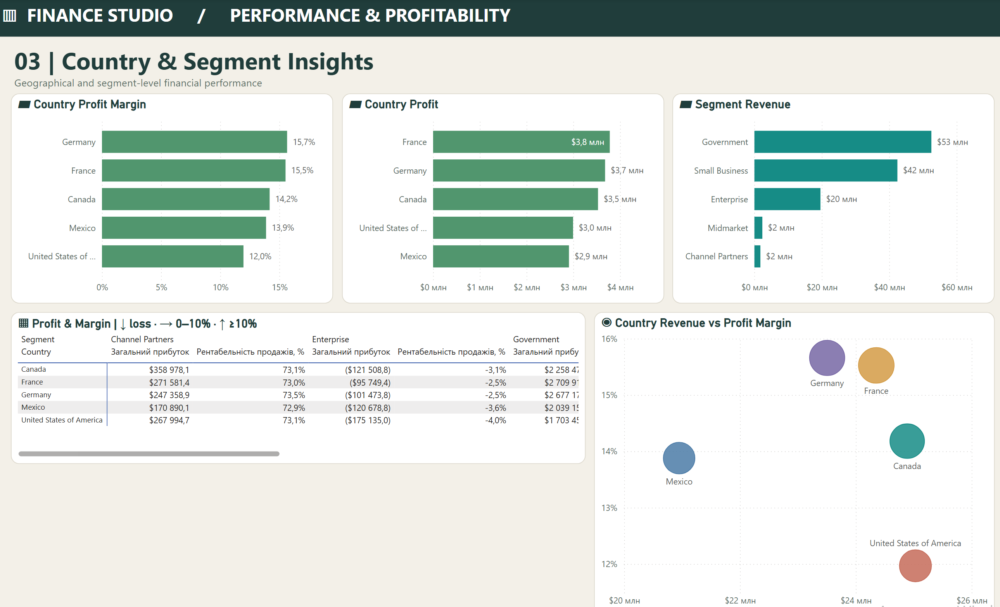

# Power BI | Financial & Profitability Analytics

## Про проєкт

Інтерактивний фінансово-аналітичний дашборд, розроблений у Microsoft Power BI для комплексного аналізу продажів, прибутковості та економічної ефективності бізнесу.

Основна мета проєкту — виявлення найбільш прибуткових продуктів, оцінка ефективності клієнтських сегментів, аналіз регіональних показників та визначення потенційних напрямів зростання бізнесу.

## 01 | Executive Financial Overview

Загальний аналіз фінансово-економічних показників компанії:

- Ключові фінансові показники (KPI).
- Загальний виторг та прибуток.
- Рентабельність продажів.
- Динаміка виторгу та прибутку.
- Економічна ефективність клієнтських сегментів.
- Структура продажів за країнами та продуктами.

## 02 | Product & Profitability

Комплексний аналіз продуктового портфеля:

- Взаємозв'язок виторгу та рентабельності.
- Матриця ефективності продуктів.
- Внесок окремих продуктів у загальний прибуток.
- Ранжування продуктів за фінансовими показниками.
- Виявлення найбільш та найменш рентабельних продуктів.

## 03 | Country & Segment Insights

Регіональний та сегментний аналіз:

- Порівняння фінансових показників за країнами.
- Аналіз прибутковості клієнтських сегментів.
- Фінансова матриця Country × Segment.
- Порівняльний аналіз економічної ефективності регіонів.
- Умовне форматування, градієнти та індикатори рентабельності.

## Аналітичні методи

- Financial Analysis
- Profitability Analysis
- KPI Analysis
- Product Portfolio Analysis
- Revenue & Profit Analysis
- Customer Segment Analysis
- Comparative Analysis
- Data Visualization
- Conditional Formatting

## Технології

- Microsoft Power BI
- DAX
- Power Query
- Data Modeling
- Business Intelligence

## Завантажити дашборд

[Завантажити Power BI (.pbix)](Financial_Analytics_Studio.pbix)

Для роботи з інтерактивним дашбордом необхідно завантажити файл та відкрити його в Microsoft Power BI Desktop.

## Портфоліо

[Переглянути всі мої Power BI проєкти](https://github.com/Litcheveckiy3477/power-bi-portfolio)
